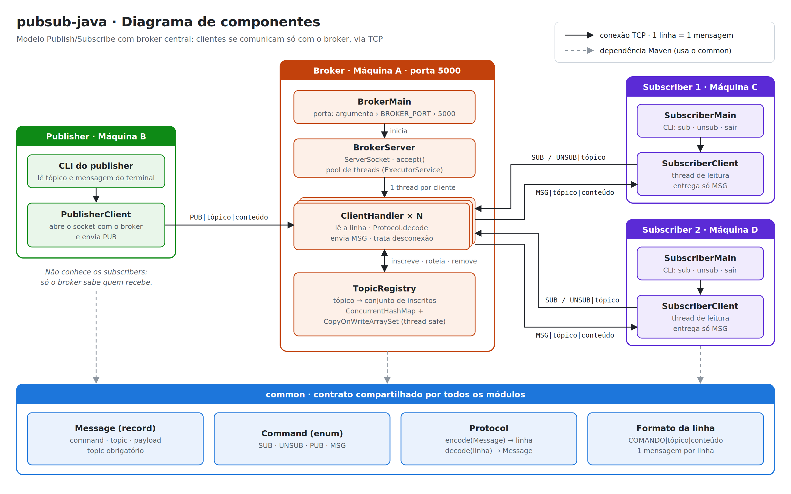
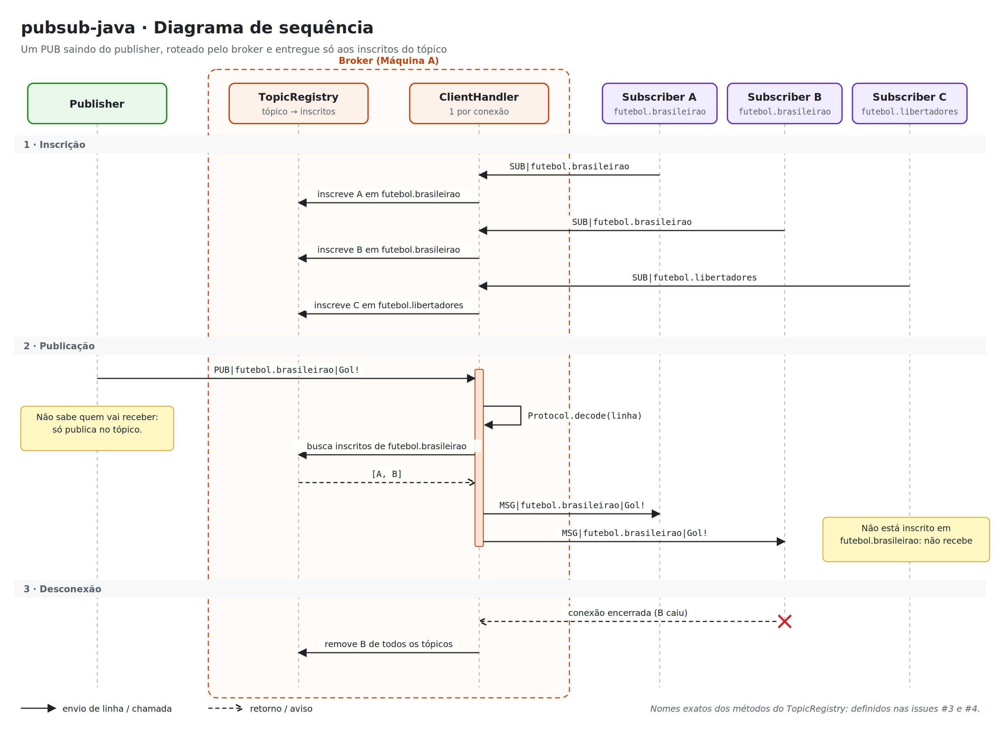

# pubsub-java

Implementação em Java do modelo **Publish/Subscribe (Pub/Sub)** para a disciplina de Sistemas Distribuídos. Um publisher envia uma mensagem para um tópico sem conhecer os subscribers; o broker recebe a publicação e a encaminha aos clientes inscritos naquele tópico.

## Equipe

| Integrante | Papel no projeto |
|---|---|
| Gabriel Carvalho | Tech lead; #1 `common`, #7 subscriber, #9 diagramas e #10 integração |
| João Pedro Abdala | #2 `BrokerServer`, #3 `ClientHandler` e #4 `TopicRegistry` |
| Yan Santos | #5 testes do `TopicRegistry` |
| Maria Eduarda | #6 publisher e #8 README |

## Tecnologias e pré-requisitos

- Java JDK 21
- Apache Maven (o projeto foi validado com Maven 3.9.14)
- Git para clonar o repositório

Confira as instalações no terminal:

```text
java -version
mvn -version
```

## Estrutura do projeto

- `common/`: mensagens, comandos e protocolo compartilhados.
- `broker/`: servidor TCP e roteamento por tópico.
- `publisher/`: cliente que publica mensagens.
- `subscriber/`: cliente que assina tópicos e recebe mensagens.
- `docs/`: diagramas da arquitetura e da sequência de publicação.

## Compilar

Na pasta raiz do repositório, compile e instale os módulos:

```bash
mvn clean install
```

## Testes

Para executar os testes automatizados de todos os módulos:

```bash
mvn test
```

## Como rodar

Inicie cada programa em um terminal separado, sempre a partir da pasta raiz.

### 1. Broker

Inicie o broker na porta padrão `5000`:

```bash
mvn -pl broker exec:java "-Dexec.args=5000"
```

### 2. Subscriber

Em outro terminal, conecte ao broker local:

```bash
mvn -pl subscriber exec:java "-Dexec.args=localhost 5000"
```

No terminal do subscriber, assine um tópico, por exemplo:

```text
sub avisos
```

Para cancelar a inscrição, use `unsub avisos`. Para encerrar, digite `sair`.

### 3. Publisher

Em um terceiro terminal, conecte o publisher ao broker:

```bash
mvn -pl publisher exec:java "-Dexec.args=localhost 5000"
```

Quando solicitado, informe o tópico `avisos` e depois digite a mensagem. Para encerrar, digite `sair` no campo de tópico.

> O encaminhamento completo entre publisher e subscriber depende da integração do `ClientHandler` ao broker (issue #3). Até essa integração, os comandos de terminal e o protocolo estão definidos, mas o fluxo de ponta a ponta ainda não está concluído.

### Executar clientes em outros computadores

Para uma demonstração em rede local, informe nos comandos do publisher e do subscriber o endereço IP do computador onde o broker está rodando, mantendo a porta `5000`. Por exemplo:

```bash
mvn -pl subscriber exec:java "-Dexec.args=192.168.1.10 5000"
mvn -pl publisher exec:java "-Dexec.args=192.168.1.10 5000"
```

Troque `192.168.1.10` pelo IP do computador do broker e permita conexões TCP na porta escolhida no firewall da rede.

## Exemplo do protocolo

O protocolo usa uma linha de texto por mensagem, com campos separados por `|`:

```text
SUB|avisos
PUB|avisos|Manutenção às 18h
MSG|avisos|Manutenção às 18h
UNSUB|avisos
```

`SUB` e `UNSUB` representam inscrição e cancelamento. `PUB` é enviado pelo publisher ao broker; `MSG` é a mensagem encaminhada pelo broker aos subscribers inscritos. Nos programas de terminal, o subscriber recebe comandos como `sub avisos`, enquanto o publisher solicita o tópico e o conteúdo.

## Arquitetura

### Diagrama de componentes



### Diagrama de sequência


